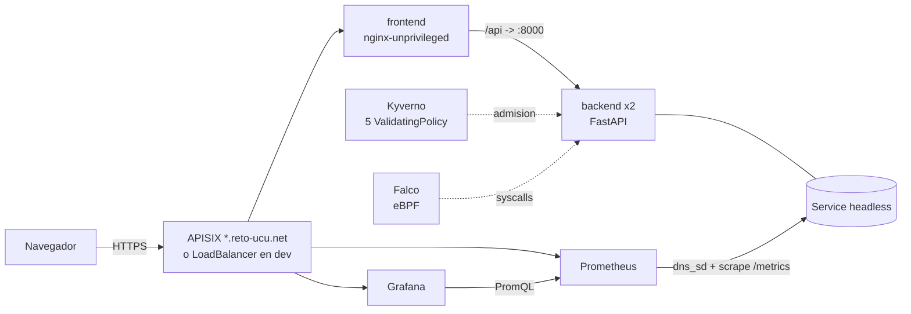

# Laboratorio 4: trabajo integrador DevOps / DevSecOps

Notes API: una API de notas (FastAPI) con frontend web, desplegada en Kubernetes con Helm,
con CI/CD en Jenkins y GitHub Actions, monitoreo con Prometheus y Grafana, y controles de
seguridad con Semgrep, Snyk, Trivy, Kyverno y Falco.

Repositorio: https://github.com/felicabrera/devops-entregable4

| Entorno | Donde | URL |
|---|---|---|
| `prod` | Cluster de la facultad, namespace `alumno-team9` | https://notes-team9.reto-ucu.net, https://grafana-team9.reto-ucu.net, https://prometheus-team9.reto-ucu.net |
| `dev` | Kubernetes de Docker Desktop, namespace `notes` | http://localhost, http://localhost:3001 (Grafana), http://localhost:9091 (Prometheus) |
| Jenkins | Docker local | http://localhost:8081 (admin / admin) |

Indice:

1. [Descripcion general](#1-descripcion-general)
2. [Arquitectura](#2-arquitectura)
3. [Como ejecutarlo paso a paso](#3-como-ejecutarlo-paso-a-paso)
4. [Contenerizacion](#4-contenerizacion)
5. [Helm chart](#5-helm-chart)
6. [Pipeline CI/CD](#6-pipeline-cicd)
7. [Metricas y dashboard de Grafana](#7-metricas-y-dashboard-de-grafana)
8. [Resultados de seguridad](#8-resultados-de-seguridad)
9. [Problemas encontrados y soluciones](#9-problemas-encontrados-y-soluciones)
10. [Conclusiones y oportunidades de mejora](#10-conclusiones-y-oportunidades-de-mejora)

## 1. Descripcion general

El proyecto parte de la Notes API de los entregables anteriores (FastAPI, un archivo JSON como
almacenamiento, metricas Prometheus) y la lleva a un sistema completo:

- **backend** (`backend/`): FastAPI + uvicorn. Endpoints `GET /`, `GET /health`, `POST /notes`,
  `GET /notes`, `GET /notes/{id}`, `DELETE /notes/{id}`, `GET /stats`, `GET /metrics`, mas los
  endpoints legacy `POST /add/{note}` y `GET /list`. Tests con pytest y lint con ruff.
- **frontend** (`frontend/`): sitio estatico (HTML, CSS, JS sin frameworks) servido por
  `nginx-unprivileged`, que proxea `/api/*` al backend para evitar CORS.
- **monitoreo**: Prometheus con reglas de alerta y Grafana con un dashboard aprovisionado
  (`grafana/dashboard.json`).
- **seguridad**: analisis estatico (Semgrep con reglas propias), dependencias (Snyk y pip-audit),
  imagenes e IaC (Trivy), politicas de admision (Kyverno, CEL) y deteccion en tiempo de ejecucion
  (Falco con reglas propias).
- **entrega**: Helm chart con `values-dev.yaml` y `values-prod.yaml`, Jenkinsfile, Jenkins
  configurado como codigo, y cuatro workflows de GitHub Actions (CI, Seguridad, CD y Release).
- **operacion**: scripts en `scripts/` para inicializar, poblar dashboards, limpiar, levantar
  Jenkins y generar la evidencia de `reports/`.

Estructura del repositorio:

```
backend/            API, tests, Dockerfile multi-stage
frontend/           sitio estatico, nginx.conf, Dockerfile multi-stage
helm-chart/         chart "notes" (templates, values, values-dev, values-prod, files/dashboard.json)
grafana/            dashboard.json exportado
monitoring/         config de Prometheus y Grafana para docker-compose
kyverno/            policies/ (5 ValidatingPolicy), test/ (manifiestos + kyverno test), values.yaml
falco/              values.yaml del chart oficial con reglas propias
jenkins/            Dockerfile de Jenkins, casc.yaml, jobs.groovy, plugins.txt, docker-compose.yml
.github/workflows/  ci.yml, security.yml, cd.yml, release.yml
.semgrep/           reglas propias de Semgrep
scripts/            init, populate, cleanup, install-operators, start-jenkins, start-all,
                    security-scan, kyverno-validate, falco-trigger, image-analysis, build-dashboard
reports/            evidencia: semgrep, snyk, trivy, image-analysis, kyverno, falco, jenkins
docs/               arquitectura.md (diagramas) y capturas
```

## 2. Arquitectura

Diagrama completo y decisiones de diseno en [docs/arquitectura.md](docs/arquitectura.md).



Un release del chart crea: 2 Deployments de app (backend y frontend), 3 Services (backend,
backend-headless, frontend), 1 ConfigMap de la app, Prometheus (ConfigMap + Deployment + Service +
PVC opcional), Grafana (Secret + 2 ConfigMaps + Deployment + Service), una NetworkPolicy que solo
deja entrar al backend desde pods del release, un `ApisixRoute` (prod) o `Ingress` (opcional), y
un pod de `helm test` que verifica los cuatro componentes.

## 3. Como ejecutarlo paso a paso

### 3.1 Requisitos

Docker Desktop con Kubernetes habilitado, `kubectl`, `helm` 3.x o 4.x, `curl`, `jq`. Para los
escaneos: `semgrep`, `snyk` (con `snyk auth`), `trivy`, `kyverno` (CLI), `kube-linter`, `dive`.
En macOS: `brew install helm kube-linter dive kyverno semgrep snyk-cli trivy`.

### 3.2 Entorno dev (Docker Desktop): todo con un script

```bash
scripts/init.sh
```

`init.sh` hace, en orden:

1. `docker build` de `notes-backend:dev` y `notes-frontend:dev` (el cluster de Docker Desktop
   comparte el daemon, no hace falta registry).
2. `scripts/install-operators.sh`: instala Kyverno (chart `kyverno/kyverno` 3.10.0, v1.20.0) con
   `kyverno/values.yaml`, aplica las cinco politicas y espera a que esten `READY`, e instala Falco
   (chart `falcosecurity/falco` 9.2.2, 0.45.2) con `falco/values.yaml`.
3. `helm upgrade --install notes helm-chart -n notes -f helm-chart/values-dev.yaml --wait`.
4. `kubectl wait` sobre los Deployments y `helm test notes --logs`.
5. `curl http://localhost/api/health` hasta que responda.

Salida esperada (resumida, ejecucion del 2026-11-11):

```
==> Instalando Kyverno (chart 3.10.0)
NAME                                             READY   STATUS    RESTARTS   AGE
kyverno-admission-controller-...                 1/1     Running   0          13s
==> Aplicando las politicas de Kyverno
NAME                             AGE     READY
disallow-latest-tag              4m36s   true
disallow-privileged-containers   4m36s   true
disallow-root-containers         4m36s   true
require-probes                   4m36s   true
require-requests-limits          4m36s   true
==> Instalando Falco (chart 9.2.2)
falco-lvl4m   2/2     Running   0          61s
==> Desplegando el chart con Helm
NAME                              READY   STATUS    RESTARTS   AGE
notes-backend-9768fd749-wzj58     1/1     Running   0          2m35s
notes-backend-9768fd749-xntvd     1/1     Running   0          2m35s
notes-frontend-64458c7955-w5j6s   1/1     Running   0          2m35s
notes-grafana-6b6497dd7d-d8zgh    1/1     Running   0          2m35s
notes-prometheus-596cd5d6-9b5n9   1/1     Running   0          2m35s
==> Prueba de humo del release (helm test)
GET http://notes-backend:8000/health
{"status":"ok","health_param":"default","version":"dev","env":"dev"}
GET http://notes-frontend:80/api/stats
{"total_notes":0,"version":"dev","env":"dev"}
GET http://notes-prometheus:9091/-/ready
Prometheus Server is Ready.
GET http://notes-grafana:3001/api/health
{"database": "ok", "version": "13.3.1"}
==> Verificando acceso externo: http://localhost
    {"status":"ok","health_param":"default","version":"dev","env":"dev"}
```

Para hacerlo a mano, el equivalente es `helm install notes ./helm-chart -f helm-chart/values-dev.yaml`
(el enunciado pide `helm install <nombre> ./helm-chart`; `init.sh` usa `upgrade --install` para
que sea idempotente).

### 3.3 Poblar los dashboards

```bash
scripts/populate.sh 90        # 90 segundos de trafico: crea/borra notas, lista, /stats, 404 y 422
```

Imprime el progreso (`rondas: 249 | notas creadas: 528 | total ahora: 191` en la corrida de
referencia). Despues abrir Grafana (http://localhost:3001, admin / admin), carpeta **Notes**,
dashboard **Notes: API, recursos y negocio**.

### 3.4 Validaciones y evidencia

```bash
scripts/kyverno-validate.sh   # aplica los manifiestos de kyverno/test y guarda reports/kyverno-validation.log
scripts/falco-trigger.sh      # ejecuta find/cat en un pod del backend y guarda reports/falco-event.log
scripts/security-scan.sh      # semgrep, snyk y trivy -> reports/*.txt
scripts/image-analysis.sh     # dive (y slim si esta disponible) -> reports/image-analysis/
```

### 3.5 Jenkins

```bash
cp jenkins/.env.example jenkins/.env   # completar SNYK_TOKEN y, si se quiere publicar en GHCR, GHCR_TOKEN
scripts/start-jenkins.sh               # construye la imagen de Jenkins y levanta Jenkins + registry local
```

Jenkins queda en http://localhost:8081 (admin / admin) con el job `notes-pipeline` ya creado por
JCasC y Job DSL. El job clona `main` del repositorio y ejecuta el `Jenkinsfile`. Parametros:
`TARGET_ENV` (dev o prod), `REGISTRY` (por defecto GHCR; `localhost:5001` usa el registry local),
`DEPLOY` y `PLATFORM`.

`scripts/start-all.sh` encadena `init.sh`, `start-jenkins.sh` y `populate.sh`.

### 3.6 Entorno prod (cluster de la facultad)

El despliegue en prod lo hace el workflow `CD` en cada push a `main` (o Jenkins con
`TARGET_ENV=prod`). Para hacerlo a mano con el kubeconfig del equipo:

```bash
export KUBECONFIG=~/Downloads/team3.kubeconfig     # cuenta team9, namespace alumno-team9
ENV_NAME=prod KUBE_CONTEXT=ucu IMAGE_TAG=sha-<commit> scripts/init.sh
ENV_NAME=prod scripts/populate.sh 60
```

Las imagenes se toman de `ghcr.io/felicabrera/devops-entregable4/{backend,frontend}:sha-<commit>`
(publicas). En prod no se instalan Kyverno ni Falco: la cuenta del equipo solo tiene permisos
dentro de su namespace (ver seccion 9).

### 3.7 Limpieza

```bash
scripts/cleanup.sh                    # dev: release, namespace, politicas, Falco, Kyverno e imagenes
scripts/cleanup.sh --keep-operators   # dev: conserva Kyverno y Falco
ENV_NAME=prod scripts/cleanup.sh      # prod: release y pods de prueba
docker compose -f jenkins/docker-compose.yml down -v   # Jenkins y registry local
```

### 3.8 Sin Kubernetes

`docker compose up -d --build` levanta backend, frontend (http://localhost:8080), Prometheus
(http://localhost:9091) y Grafana (http://localhost:3001) con la misma configuracion de alertas y
el mismo dashboard. `APP_URL=http://localhost:8080 scripts/populate.sh 60` genera trafico.

## 4. Contenerizacion

Un Dockerfile por componente, ambos multi-stage, con etiquetas fijas y usuario no root:

| Imagen | Base | Etapas | Usuario | Tamano |
|---|---|---|---|---|
| `notes-backend` | `python:3.13.18-slim-bookworm` | `builder` (venv con pip) y `runtime` (sin pip ni cache) | `10001:10001` | 259 MB (base: 206 MB) |
| `notes-frontend` | `nginxinc/nginx-unprivileged:1.31.7-alpine` | `builder` (alpine + gzip precomprime el sitio) y `runtime` | `101` | 101 MB (base: 91 MB) |

Prometheus (`prom/prometheus:v3.16.0`), Grafana (`grafana/grafana:13.3.1`) y Jenkins
(`jenkins/jenkins:2.580.2-lts-jdk21` extendido en `jenkins/Dockerfile` con docker, helm, kubectl,
trivy, semgrep, snyk y kyverno) usan imagenes oficiales con version fija.

El analisis de tamano y capas (dive) esta en [reports/image-analysis.md](reports/image-analysis.md),
con la salida cruda en `reports/image-analysis/`. Resumen: la base aporta mas del 75 % de cada
imagen; el multi-stage deja fuera pip, setuptools y la cache; las capas de `apt-get upgrade` /
`apk upgrade` son el unico costo adicional (4 y 6 MB) y duplican librerias de la base. SlimToolkit
no pudo leer las imagenes del almacen containerd de Docker Desktop 29, por eso se uso dive.

Escaneo con Trivy: ver seccion 8.3.

## 5. Helm chart

`helm-chart/` (chart `notes`, version 1.0.0, appVersion 4.0.0).

| Template | Recurso |
|---|---|
| `backend-deployment.yaml`, `backend-service.yaml`, `backend-configmap.yaml` | Deployment (RollingUpdate `maxUnavailable: 0`, anti-afinidad, probes, `readOnlyRootFilesystem`, `emptyDir` en `/data`), Service ClusterIP + Service headless, ConfigMap con `API_TITLE`, `WELCOME_MESSAGE`, `HEALTH_PARAM`, `MAX_NOTE_LENGTH`, `APP_ENV` |
| `backend-hpa.yaml`, `backend-pdb.yaml` | HPA y PDB opcionales |
| `frontend-deployment.yaml`, `frontend-service.yaml` | Deployment de nginx (cache, tmp y conf en `emptyDir`) y Service |
| `ingress.yaml`, `apisixroute.yaml` | Ingress (clase configurable) o ApisixRoute (cluster de la facultad) |
| `prometheus-*.yaml` | ConfigMap (scrape + 4 reglas de alerta parametrizadas), Deployment, Service, PVC opcional |
| `grafana-*.yaml` | Secret (admin), ConfigMaps de provisioning y dashboard, Deployment, Service |
| `networkpolicy.yaml` | Solo pods del release pueden hablar con el backend |
| `tests/test-connection.yaml` | Pod de `helm test` que consulta backend, frontend, Prometheus y Grafana |

`values.yaml` expone imagen (registry, repositorio, tag, pullPolicy), replicas, puertos, tipo de
Service, recursos, probes, configuracion de la app, hosts, retencion y persistencia de Prometheus,
umbrales de las alertas, credenciales de Grafana y contexto de seguridad.

| | `values-dev.yaml` | `values-prod.yaml` |
|---|---|---|
| Imagenes | `notes-backend:dev` locales, `IfNotPresent` | `ghcr.io/felicabrera/devops-entregable4/{backend,frontend}:<sha>`, `Always` |
| Exposicion | Services `LoadBalancer` (localhost:80, 9091, 3001) | `ApisixRoute` con `notes-team9`, `grafana-team9`, `prometheus-team9.reto-ucu.net` |
| Replicas | backend 2, frontend 1 | backend 2, frontend 2 |
| Prometheus | retencion 2d, PVC 1Gi | retencion 7d, PVC 2Gi |
| NetworkPolicy | si | si |
| PDB | no | no (la cuenta no puede crear PDB) |

Validaciones automaticas del chart en CI: `helm lint` con los tres values, `kube-linter` sobre los
manifiestos renderizados (`.kube-linter.yaml`), `kyverno apply` de las cinco politicas sobre los
manifiestos renderizados y comprobacion de que `grafana/dashboard.json` y la copia embebida en el
chart son identicos.

## 6. Pipeline CI/CD

### 6.1 Jenkins (`Jenkinsfile`)

| Etapa | Herramienta | Que hace | Corta el pipeline si |
|---|---|---|---|
| Checkout | git | Clona el repositorio y fija `IMAGE_TAG=<sha>` | |
| Analisis estatico | Semgrep 1.185 | `.semgrep/` + `p/python`, `p/dockerfile`, `p/kubernetes`, `p/secrets`; guarda texto y SARIF | hay hallazgos (`--error`) |
| Dependencias | Snyk | `snyk test` sobre `requirements.txt` y `snyk monitor` | HIGH o CRITICAL |
| Build y test | ruff, pytest, helm, kyverno | lint + formato, tests con JUnit, `helm lint`, `kyverno apply` y `kyverno test` | falla un test o una politica |
| Imagen Docker | buildx | `linux/amd64` por defecto (los nodos de la facultad) | |
| Escaneo de imagen | Trivy | HIGH/CRITICAL con parche en el log; bloquea con CRITICAL que tenga parche | CRITICAL con parche |
| Publicar imagen | docker | GHCR con la credencial `ghcr-credentials`, o registry local | |
| Despliegue | Helm | `helm upgrade --install` con `values-<env>.yaml` y el kubeconfig de la credencial | el rollout no termina |
| Prueba de humo | Helm | `helm test --logs` | falla el pod de prueba |

`post`: archiva `reports/jenkins/**` (semgrep, snyk, trivy, pytest.xml, manifiestos renderizados) y
borra las imagenes locales.

Jenkins se levanta con `jenkins/docker-compose.yml`: la imagen `jenkins/Dockerfile` instala los
plugins de `plugins.txt`, `casc.yaml` crea el usuario admin, las credenciales (`snyk-token`,
`ghcr-credentials`, `kubeconfig-dev`, `kubeconfig-prod`) a partir de variables de entorno y
archivos montados, y `jobs.groovy` crea el job `notes-pipeline` con polling SCM cada 5 minutos.

### 6.2 GitHub Actions

| Workflow | Disparador | Jobs |
|---|---|---|
| `CI` | push, PR | backend (ruff, pytest), frontend (`nginx -t`), hadolint x3, shellcheck, helm (lint, kube-linter, kyverno apply/test, dashboard sincronizado), validacion del Jenkinsfile contra un Jenkins real (`pipeline-model-converter/validate`) |
| `Seguridad` | push, PR, lunes 06:00 UTC | Semgrep (SARIF a Code Scanning), Snyk + pip-audit, Trivy por imagen (SARIF; bloquea con CRITICAL con parche), Trivy IaC sobre todo el repo |
| `CD` | push a `main` | build amd64 con cache, Trivy, push a GHCR (`sha-<commit>` y `latest`), `helm upgrade --install` en `alumno-team9`, `helm test`, smoke test por APISIX, rollback automatico si falla |
| `Release del chart` | tag `v*` | `helm package` y `helm push` a `oci://ghcr.io/felicabrera/devops-entregable4/charts`, GitHub Release |

Todas las acciones estan fijadas por SHA de commit (requisito de la regla
`github-actions-mutable-action-tag` de Semgrep). Secretos usados: `KUBECONFIG_PROD` (kubeconfig en
base64), `SNYK_TOKEN` y opcionalmente `GRAFANA_ADMIN_PASSWORD`.

## 7. Metricas y dashboard de Grafana

El backend expone `/metrics` con `prometheus-client`:

| Metrica | Tipo | Uso |
|---|---|---|
| `http_request_duration_seconds` (`method`, `endpoint`, `status`) | Histogram | RPS, latencia promedio y percentiles, errores por codigo |
| `notes_total` | Gauge | notas guardadas (metrica de negocio) |
| `notes_created_total`, `notes_deleted_total` | Counter | ritmo de creacion y borrado, alerta `MuchasNotasCreadas` |
| `process_cpu_seconds_total`, `process_resident_memory_bytes`, `process_open_fds` | Gauge/Counter | CPU y memoria por pod |
| `up` | | replicas arriba |

Prometheus descubre cada pod del backend por DNS (`notes-backend-headless`), scrapea cada 5 s y
evalua cuatro alertas: `BackendCaido`, `MuchasNotasCreadas` (mas de 10 notas en 5 min),
`LatenciaAlta` (p95 > 0,5 s) y `TasaDeErrores` (mas de 5 % de 5xx). Los umbrales son values del chart.

Dashboard `grafana/dashboard.json` (uid `notes-api`, generado por `scripts/build-dashboard.py`,
26 paneles en seis filas):

| Fila | Paneles |
|---|---|
| Resumen | RPS, latencia promedio, p95, % de 5xx, notas guardadas, replicas arriba |
| Trafico | RPS por endpoint, por codigo de estado y por pod |
| Latencia | promedio por endpoint, p50/p95/p99, p95 por pod |
| Recursos por pod | CPU, memoria residente, descriptores abiertos |
| Negocio | notas guardadas en el tiempo, creadas/borradas por minuto, creadas en 5 min contra el umbral |
| Estado | targets `up`, uptime por pod |

Variables: `endpoint` (multi-select) y `threshold` (umbral de la alerta). Captura tras
`scripts/populate.sh`: [docs/img/grafana-dashboard.png](docs/img/grafana-dashboard.png).

## 8. Resultados de seguridad

| Reporte | Archivo |
|---|---|
| Semgrep | [reports/semgrep-report.txt](reports/semgrep-report.txt) |
| Snyk | [reports/snyk-report.txt](reports/snyk-report.txt) |
| Trivy (imagenes e IaC) | [reports/trivy-report.txt](reports/trivy-report.txt) |
| Analisis de imagen | [reports/image-analysis.md](reports/image-analysis.md) |
| Kyverno | [reports/kyverno-validation.log](reports/kyverno-validation.log) |
| Falco | [reports/falco-event.log](reports/falco-event.log) |
| Jenkins | [reports/jenkins-console.log](reports/jenkins-console.log) |

### 8.1 Semgrep

Reglas propias en `.semgrep/python-security.yaml` (cinco, especificas de Python y FastAPI):
`notes-python-no-eval-exec` (CWE-95), `notes-python-subprocess-shell-true` (CWE-78),
`notes-fastapi-cors-wildcard-with-credentials` (CWE-942), `notes-fastapi-path-from-user-input`
(CWE-22) y `notes-python-insecure-hash` (CWE-328). Se suman los packs `p/python`, `p/dockerfile`,
`p/kubernetes`, `p/secrets` y `p/owasp-top-ten`.

Resultado final: `Ran 335 rules on 78 files: 0 findings`. Hallazgos que aparecieron durante el
desarrollo y como se resolvieron:

| Hallazgo | Archivo | Resolucion |
|---|---|---|
| `github-actions-mutable-action-tag` (3) | workflows | Todas las acciones fijadas por SHA de commit |
| `request-host-used` | `frontend/nginx.conf` | Se quito `proxy_set_header Host $host`; nginx usa `$proxy_host` |
| `run-as-non-root`, `privileged-container`, `hostnetwork-pod`, etc. (12) | `kyverno/test/*.yaml` | Son los manifiestos no conformes que Kyverno debe rechazar; se excluyen en `.semgrepignore` |
| `run-as-non-root` (5) | `kyverno/policies/*.yaml` | Falso positivo: Semgrep lee los `spec:` de las politicas como PodSpec; excluidos en `.semgrepignore` |

### 8.2 Snyk

`snyk test --file=backend/requirements.txt --package-manager=pip --severity-threshold=high` sobre
las dependencias instaladas (fastapi 0.162.0, uvicorn 0.54.0, prometheus-client 0.26.0 y sus
transitivas) y `snyk code test` sobre `backend/`. El resultado esta en
`reports/snyk-report.txt`; como segunda opinion, CI corre `pip-audit --strict`. En el pipeline
cualquier vulnerabilidad HIGH o CRITICAL detiene la ejecucion antes de construir la imagen.

### 8.3 Trivy

`trivy image --severity HIGH,CRITICAL --ignore-unfixed` sobre las dos imagenes y
`trivy config` sobre Dockerfiles, chart, Kubernetes y workflows (sin hallazgos HIGH/CRITICAL).

| Imagen | HIGH/CRITICAL con parche | CRITICAL sin parche | Decision |
|---|---|---|---|
| `notes-backend` | 0 | 2: `CVE-2025-7458` (libsqlite3-0, integer overflow) y `CVE-2023-45853` (zlib1g, `will_not_fix` por Debian) | Aceptadas: la app no usa SQLite ni descomprime datos de usuario con zlib; el contenedor corre sin root, sin capabilities y con filesystem de solo lectura. Se revisan en el escaneo semanal. |
| `notes-frontend` | 0 | 0 | |

Criterio del pipeline: una CRITICAL **con parche disponible** detiene la ejecucion (Jenkins, CD y
Seguridad). Las que no tienen parche se documentan aqui y quedan visibles en Code Scanning.

### 8.4 Kyverno

Kyverno 1.20 dejo de ejecutar las `ClusterPolicy` legadas, asi que las politicas son
`ValidatingPolicy` (CEL) en `kyverno/policies/`:

| Politica | Regla |
|---|---|
| `disallow-latest-tag` | etiqueta o digest obligatorio y distinto de `latest` en containers, initContainers y ephemeralContainers |
| `require-requests-limits` | `requests` y `limits` de cpu y memoria en containers e initContainers |
| `disallow-root-containers` | `runAsNonRoot: true` (pod o contenedor) y `runAsUser != 0` |
| `disallow-privileged-containers` | sin `privileged`, `allowPrivilegeEscalation: false`, `capabilities.drop: [ALL]`, sin hostPID/hostIPC/hostNetwork |
| `require-probes` | readiness y liveness en Deployments, StatefulSets y DaemonSets |

Las cinco estan en `Deny`, con `background` activo, y excluyen los namespaces del sistema, `kyverno`,
`falco` y `jenkins`. Kyverno las autogenera tambien para Deployments, Jobs y CronJobs.

Evidencia (`reports/kyverno-validation.log`): `kyverno test` pasa 29 casos; en el cluster, los
siete manifiestos no conformes fueron **rechazados** por el webhook con el mensaje de la politica
correspondiente, `pod-conforme.yaml` fue **aceptado**, y `kubectl debug --image=busybox:latest`
sobre ese pod fue **rechazado** (contenedor efimero con `latest`). Fragmento:

```
$ kubectl apply -n notes -f kyverno/test/pod-root.yaml
Error from server: admission webhook "vpol.validate.kyverno.svc-fail-finegrained-disallow-root-containers"
denied the request: Policy disallow-root-containers failed: Los contenedores no pueden ejecutarse
como root: defina securityContext.runAsNonRoot: true.
RESULTADO: RECHAZADO
```

### 8.5 Falco

Falco 0.45.2 (chart 9.2.2, driver `modern_ebpf`) con dos reglas propias en `falco/values.yaml`:
`Lectura del archivo de notas por un proceso inesperado` (cualquier proceso que no sea el servidor
abre `/data/notes.json`) y `Busqueda de credenciales en el contenedor` (`find`/`grep` buscando
claves o contrasenas).

Acciones ejecutadas por `scripts/falco-trigger.sh` sin abrir una shell:

1. `kubectl exec <pod> -- find / -name id_rsa`: busqueda de claves privadas. Dispara la regla por
   defecto `Search Private Keys or Passwords` (prioridad Warning, tags `mitre_credential_access`,
   `T1552.001`). Como Falco usa `rule_matching: first`, la regla propia equivalente queda como
   respaldo.
2. `kubectl exec <pod> -- cat /data/notes.json`: lectura del almacenamiento de la app por un proceso
   ajeno. Dispara la regla propia `Lectura del archivo de notas por un proceso inesperado`.

`reports/falco-event.log` contiene las dos alertas en JSON con usuario (`uid 10001`), proceso,
linea de comando, contenedor, imagen, pod y namespace.

## 9. Problemas encontrados y soluciones

| Problema | Solucion |
|---|---|
| Kyverno 1.20 rechaza crear `ClusterPolicy` (`kyverno.io/v1`): "removed execution of legacy policy types" | Se migraron las cinco politicas a `ValidatingPolicy` con CEL. Las pruebas (`kyverno test`, `kyverno apply`) y la validacion en el cluster se rehicieron con el nuevo tipo. |
| Las politicas CEL bloqueaban al DaemonSet de Falco aunque `falco` estaba excluido | Kyverno autogenera las reglas para workloads y reescribe `object.metadata.namespace` como `object.spec.template.metadata.namespace` (vacio). La exclusion se paso a `request.namespace`. |
| Tres politicas quedaban `READY=false`: el reports controller no tenia permisos sobre `pods/ephemeralcontainers` | `kyverno/values.yaml` agrega `reportsController.rbac.clusterRole.extraResources`. |
| Instalacion de Kyverno fallida a medias (job `check-legacy-policies` sin poder bajar la imagen) dejaba el release en estado `failed` | `install-operators.sh` desinstala el release si no esta `deployed` antes de reintentar. |
| En el cluster de la facultad la cuenta del equipo no puede crear Roles, CRDs, PDB ni Services `LoadBalancer` | Prometheus usa `dns_sd_configs` sobre un Service headless (sin RBAC), el PDB se desactiva en prod, la exposicion es por `ApisixRoute`, y Kyverno/Falco se validan en el cluster local y en CI. |
| El primer despliegue por CD fallo por el PDB (`cannot get resource poddisruptionbudgets`) | `values-prod.yaml` con `podDisruptionBudget.enabled: false`. |
| `nginx -t` en CI fallaba con `host not found in upstream "backend"` | nginx resuelve el `proxy_pass` al arrancar; el test corre con `--add-host backend:127.0.0.1`. |
| El linter declarativo de Jenkins rechazaba `timestamps()` | El Jenkins efimero de CI instala `timestamper` y `junit` ademas de `pipeline-model-definition`. |
| Semgrep marcaba acciones de GitHub con tags mutables | Todas las `uses:` se fijaron al SHA del commit del tag. |
| SlimToolkit no pudo analizar las imagenes (Docker Desktop 29, almacen containerd) | Se uso dive para el analisis de capas y se documento el fallo en `reports/image-analysis.md`. |
| El puerto 5000 del registry local esta ocupado por AirPlay en macOS | El registry se publica en `localhost:5001`. |
| Trivy encontro 2 CRITICAL sin parche en la base Debian del backend | Se aceptan documentadas (seccion 8.3) y el pipeline bloquea solo las CRITICAL con parche disponible. |
| Docker Desktop perdio DNS varias veces durante las construcciones | Reintentos; `install-operators.sh` tolera que una politica tarde en quedar lista. |

## 10. Conclusiones y oportunidades de mejora

El proyecto cubre el ciclo completo: codigo con tests y lint, imagenes reproducibles y escaneadas,
despliegue declarativo con Helm en dos entornos, dos pipelines (Jenkins y GitHub Actions) que
frenan ante vulnerabilidades, monitoreo con alertas y un dashboard de RPS, latencia, recursos y
negocio, politicas de admision probadas en CI y en el cluster, y deteccion en tiempo de ejecucion
con reglas propias.

Mejoras pendientes:

- **Persistencia real de las notas.** Hoy cada pod guarda su propio JSON en un `emptyDir`; dos
  replicas no comparten datos. El siguiente paso es una base de datos (PostgreSQL con su chart) o
  un PVC `ReadWriteMany`.
- **Metricas del kubelet.** CPU y memoria por pod salen del proceso de Python; con `kube-state-metrics`
  y cAdvisor se tendria la vision del contenedor completo (requiere RBAC de cluster).
- **Alertmanager y notificaciones.** Las alertas se evaluan en Prometheus pero no se envian a
  ningun canal; Alertmanager con Slack o correo cerraria el ciclo. Falcosidekick haria lo mismo con
  los eventos de Falco.
- **Imagenes mas chicas.** Una base distroless o Alpine para el backend bajaria la imagen a menos
  de 100 MB (ver `reports/image-analysis.md`).
- **Firma y atestacion de imagenes.** Cosign + una `ImageValidatingPolicy` de Kyverno que exija la
  firma antes de admitir un pod.
- **GitOps.** Reemplazar el `helm upgrade` del pipeline por Argo CD o Flux apuntando al chart
  publicado en OCI.
