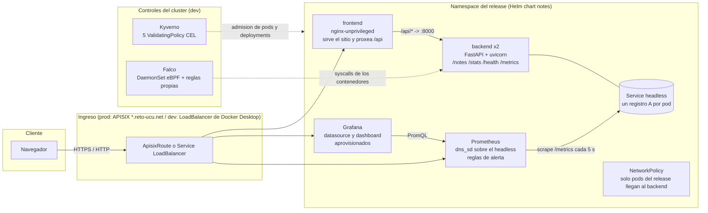
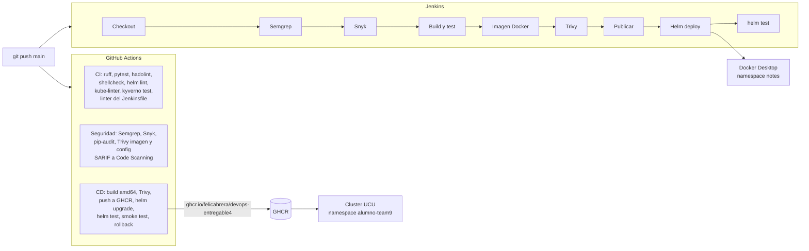

# Arquitectura

## Componentes

## Flujo de entrega

## Decisiones

| Tema | Decision | Motivo |
|---|---|---|
| Descubrimiento de targets | `dns_sd_configs` sobre un Service headless | En el cluster de la facultad la cuenta del equipo no puede crear Roles, asi que Prometheus no puede usar `kubernetes_sd_configs`. El headless publica un registro A por pod y cada replica queda como target propio sin RBAC. |
| Exposicion en prod | `ApisixRoute` con hosts `*-team9.reto-ucu.net` | El namespace tiene `services.loadbalancers: 0` y el cluster usa ingress-apisix con certificado wildcard. |
| Exposicion en dev | Services `LoadBalancer` | Docker Desktop los publica en `localhost` sin ingress controller. |
| Politicas de Kyverno | `ValidatingPolicy` (CEL) | Kyverno 1.20 ya no ejecuta `ClusterPolicy` (kyverno.io/v1). Las politicas se escriben una sola vez en CEL y se prueban con `kyverno test` y `kyverno apply` sobre los manifiestos renderizados. |
| Kyverno y Falco en prod | No se instalan | Necesitan CRDs, ClusterRoles y DaemonSets privilegiados; la cuenta del equipo solo tiene permisos de namespace. Se validan en el cluster local y en CI. |
| Datos de las notas | `emptyDir` por pod | La app guarda un JSON por proceso (como en los entregables anteriores). Dos replicas no comparten notas; es suficiente para el laboratorio y queda documentado como mejora. |
| Imagenes | Multi-stage, Debian slim y nginx-unprivileged | Ver `reports/image-analysis.md`. |
